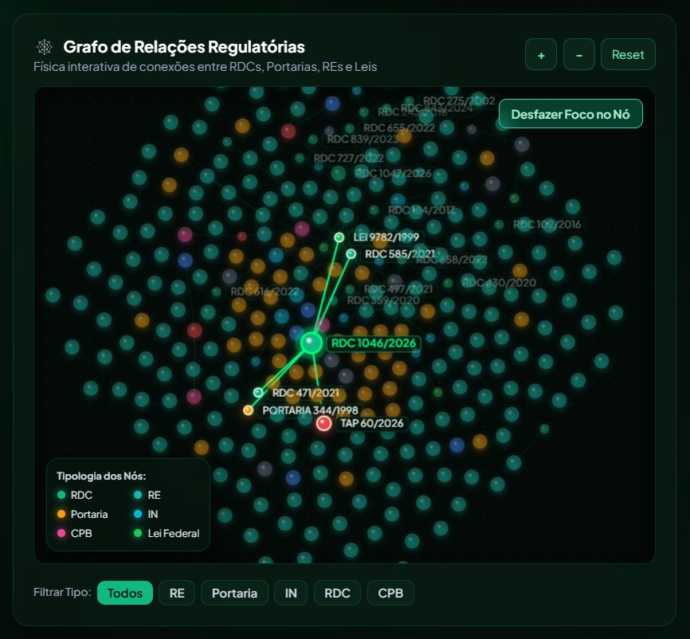

# 🏛️ AnvisaNormas

<p align="center">
  <strong>Base de Dados Aberta de Normas da Anvisa em Markdown, SQLite, JSON & Grafo de Conexões</strong><br>
  Pronta para Inteligência Artificial, RAG, Compliance Farmacêutico e Análises Regulatórias
</p>

<p align="center">
  <a href="README.md">🇧🇷 Português</a> •
  <a href="README_EN.md">🇺🇸 English</a>
</p>

<p align="center">
  <a href="LICENSE"></a>
  <a href=".github/workflows/atualiza.yml"></a>
  <a href="https://jadsonsanches.github.io/anvisa-normas/"></a>
  <a href="data/dist/anvisa.db"></a>
  <a href="#-formato-padronizado-de-cada-norma"></a>
  <a href="data/grafo/relacoes.json"></a>
</p>

---

## 📌 Visão Geral

O **AnvisaNormas** transforma o acervo normativo da **Agência Nacional de Vigilância Sanitária (Anvisa)** em uma infraestrutura moderna de dados abertos. Cada resolução (RDC), instrução normativa (IN), portaria ou resolução especial (RE) é convertida em texto simples (Markdown), enriquecida com metadados estruturados (YAML Frontmatter), conectada em um **Grafo de Relações Regulatórias** determinístico e compilada em bases consolidadas (**SQLite, JSON e CSV**).

> 🌐 **Acesse a Demonstração Interativa:** Explore o grafo e faça buscas em tempo real em [jadsonsanches.github.io/anvisa-normas](https://jadsonsanches.github.io/anvisa-normas/).

Inspirado nas iniciativas de transparência pública do [ctresb/leis](https://github.com/ctresb/leis) (Legislação Federal) e do [Bruno Moniz](https://github.com/BrunooMoniz/normas-bcb) (Banco Central e CVM).

---

## 📸 Interface & Grafo Regulatório

O projeto conta com um visualizador interativo cliente-side que roda diretamente no navegador, permitindo navegar visualmente pelas conexões jurídicas entre normas.

<p align="center">
  
  <br>
  <em>Grafo de física interativa: conexões determinísticas entre RDCs, Portarias, REs, INs e Leis Federais.</em>
</p>

<p align="center">
  
  <br>
  <em>Inspetor de Metadados: status de vigência, datas oficiais (Ato vs DOU), ementa completa e nós conectados no grafo.</em>
</p>

---

## 🎯 Por que este repositório existe?

Profissionais de **Assuntos Regulatórios, Jurídico, Compliance, P&D, Indústria Farmacêutica, Cosméticos, Alimentos e HealthTechs** frequentemente enfrentam:
- Portais governamentais instáveis, buscas lentas e PDFs escaneados ou com formatação quebrada.
- Dificuldade em rastrear se uma norma ainda está **vigente**, quais artigos foram revogados ou alterados e em qual Lei Federal ela se fundamenta.
- Falta de texto limpo para alimentar modelos de linguagem (LLMs), agentes autônomos e sistemas RAG (Retrieval-Augmented Generation).

### O que este projeto entrega:
- ✅ **Texto Integral em Markdown:** Arquivos leves, limpos e versionados no Git.
- ✅ **Metadados Ricos (YAML Frontmatter):** Situação jurídica oficial (`vigente` / `revogada`), ementa, datas distintas (**Data do Ato** vs **Data de Publicação no DOU**), leis-base e referências cruzadas.
- ✅ **Grafo Determinístico (`relacoes.json`):** Mapeamento preciso de citações, alterações e revogações — sem alucinações de inteligência artificial.
- ✅ **Bancos Prontos para Consumo:** Arquivos consolidados em **SQLite (`anvisa.db`)**, **JSON** e **CSV** gerados a cada atualização.
- ✅ **Pipeline Contínuo e Automatizado:** GitHub Actions executado a cada 6 horas coletando novos atos normativos diretamente da fonte oficial.
- ✅ **AI & RAG Ready:** Ideal para chunking semântico, embeddings e agentes de suporte regulatório.

---

## 📊 Estatísticas do Acervo

| Indicador | Quantidade |
| :--- | :--- |
| 📜 **Normas Catalogadas** | **+14.300** |
| 🟢 **Normas Vigentes** | **+14.200** |
| 🔗 **Conexões no Grafo Regulatório** | **+26.300** |
| 📂 **Tipos de Atos Cobertos** | RDC, Portaria, RE, IN, CPB, Leis Federais e mais |

---

## 💾 Downloads Diretos (Bancos Consolidados)

Para cientistas de dados, engenheiros de IA e analistas de BI, disponibilizamos os arquivos prontos na pasta [`data/dist/`](data/dist):

| Formato | Arquivo | Tamanho / Descrição |
| :--- | :--- | :--- |
| 🗄️ **SQLite 3** | [`data/dist/anvisa.db`](data/dist/anvisa.db) | Banco relacional completo com tabelas indexadas `normas` e `relacoes`. |
| 📦 **JSON Consolidado** | [`data/dist/normas.json`](data/dist/normas.json) | Objeto estruturado com todas as normas, metadados e textos integrais. |
| 📊 **CSV Estruturado** | [`data/dist/normas.csv`](data/dist/normas.csv) | Tabela compatível com Excel, Pandas e ferramentas de BI. |
| 🕸️ **Grafo Completo** | [`data/grafo/relacoes.json`](data/grafo/relacoes.json) | Lista de nós (nodes) e arestas direcionadas (links) para análises de rede. |

---

## 💻 Como Usar em Python

### 1. Consultar Normas via SQLite & Pandas

```python
import sqlite3
import pandas as pd

# Conectar ao banco SQLite consolidado
conn = sqlite3.connect("data/dist/anvisa.db")

# Consultar RDCs vigentes mais recentes
query = """
    SELECT tipo, numero, ano, data_ato, data_publicacao_dou, ementa 
    FROM normas 
    WHERE tipo = 'RDC' AND situacao = 'vigente'
    ORDER BY ano DESC, numero DESC
    LIMIT 10
"""
df = pd.read_sql_query(query, conn)
print(df)
```

### 2. Carregar o Grafo de Relações com NetworkX

```python
import json
import networkx as nx

# Carregar o grafo de relações regulatórias
with open("data/grafo/relacoes.json", "r", encoding="utf-8") as f:
    grafo_data = json.load(f)

G = nx.DiGraph()

# Adicionar nós e arestas
for node in grafo_data["nodes"]:
    G.add_node(node["id"], tipo=node.get("tipo"), titulo=node.get("titulo"))

for link in grafo_data["links"]:
    G.add_edge(link["source"], link["target"], relacao=link.get("tipo"))

print(f"Total de Nós: {G.number_of_nodes()} | Total de Arestas: {G.number_of_edges()}")
```

---

## 📑 Formato Padronizado de Cada Norma

Cada ato presente no repositório (`data/normas/`) possui um cabeçalho estruturado no padrão YAML Frontmatter:

```markdown
---
tipo: "RDC"
numero: "1046"
ano: "2026"
data_ato: "29/10/2026"
data_promulgacao: "29/10/2026"
data_publicacao_dou: "03/11/2026"
situacao: "vigente"
ementa: "Altera a Resolução de Diretoria Colegiada nº 1.000, de 11 de dezembro de 2025, que dispõe sobre os requisitos de controle para Notificações de Receita..."
leis_base: ["LEI 9782/1999"]
relacionadas: ["RDC 1000/2025", "RDC 585/2021", "PORTARIA 344/1998", "RDC 471/2021", "TAP 60/2026"]
fonte: "https://anvisalegis.datalegis.net/action/ActionDatalegis.php?..."
---

# RESOLUÇÃO DA DIRETORIA COLEGIADA - RDC Nº 1.046, DE 29 DE OUTUBRO DE 2026

O Diretor-Presidente da Agência Nacional de Vigilância Sanitária...

Art. 1º Esta Resolução altera a Resolução de Diretoria Colegiada - RDC nº 1.000...
```

---

## 📂 Estrutura do Repositório

```text
anvisa-normas/
├── docs/
│   └── assets/                   # 🖼️ Imagens do visualizador e logotipos
├── data/
│   ├── dist/                     # 💾 Bancos de dados consolidados (SQLite, JSON, CSV)
│   │   ├── anvisa.db             # Banco SQLite 3 relacional
│   │   ├── normas.json           # Base JSON completa
│   │   └── normas.csv            # Tabela CSV
│   ├── normas/                   # 📄 Atos normativos individuais em Markdown (.md)
│   │   ├── rdc/                  # Resoluções da Diretoria Colegiada
│   │   ├── portaria/             # Portarias
│   │   ├── in/                   # Instruções Normativas
│   │   └── re/                   # Resoluções Especiais
│   └── grafo/
│       ├── relacoes.json         # Nós e conexões do grafo regulatório
│       └── estatisticas.json     # Métricas consolidadas do acervo
├── scripts/
│   ├── parser.js                # Higienização de HTML e conversão para Markdown
│   ├── scraper.js               # Coletor integrado à busca oficial da Anvisa
│   ├── grafo.js                 # Construtor determinístico do grafo
│   ├── exportar-bancos.js       # Exportador consolidado (SQLite, JSON, CSV)
│   ├── gerar-visualizador.js    # Compilador do visualizador web estático
│   └── pipeline.js              # Orquestrador geral de atualização contínua
├── index.html                   # Visualizador interativo publicado no GitHub Pages
└── .github/
    └── workflows/
        └── atualiza.yml         # Automação periódica (cron a cada 6h)
```

---

## 🚀 Execução Local

### Pré-requisitos
* [Node.js](https://nodejs.org/) (versão 20 ou superior recomendada)
* Git instalado

### Instalação
```bash
git clone https://github.com/jadsonsanches/anvisa-normas.git
cd anvisa-normas
npm install
```

### Comandos Principais
```bash
# Executa o pipeline completo: coleta, parse, grafo, bancos e visualizador
npm run pipeline

# Coleta atos de uma data específica (DD/MM/AAAA)
node scripts/pipeline.js --data 12/11/2026

# Coleta atos de um ano específico
node scripts/pipeline.js --ano 2026

# Exporta apenas os bancos consolidados (SQLite, JSON, CSV)
npm run exportar:bancos

# Reconstrói apenas o visualizador web estático
npm run gerar:visualizador
```

---

## 🤝 Como Contribuir

Contribuições são muito bem-vindas! Você pode contribuir:
- Reportando inconsistências de texto ou links em atos específicos via [Issues](https://github.com/jadsonsanches/anvisa-normas/issues).
- Sugerindo novas regras de extração e relacionamentos no `scripts/grafo.js`.
- Aprimorando o visualizador em `index.html`.

Para mais detalhes, confira o nosso [Guia de Contribuição](CONTRIBUTING.md).

---

## ⚖️ Aviso Legal & Licença

* **Código-fonte:** Licenciado sob a [MIT License](LICENSE).
* **Textos Normativos:** Conforme o art. 8º, inciso IV da Lei Federal nº 9.610/1998 (Lei de Direitos Autorais brasileira), os textos de leis, decretos, resoluções e regulamentos oficiais são de **domínio público**.
* **Isenção de Responsabilidade:** Este projeto é uma iniciativa independente de dados abertos para fins de pesquisa, tecnologia e facilitação do acesso à informação. Ele não substitui as publicações oficiais no [Diário Oficial da União (DOU)](https://in.gov.br/) nem no portal institucional da Anvisa.
