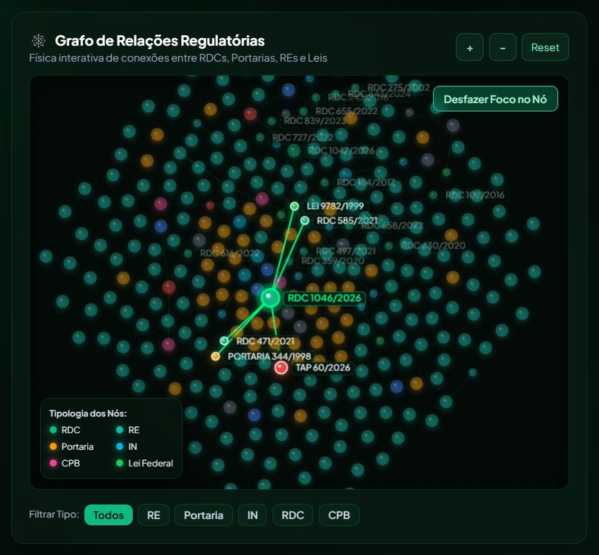
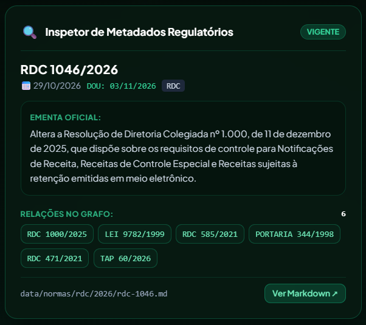

# 🏛️ AnvisaNormas

<p align="center">
  <strong>Open Dataset of Anvisa Regulations in Markdown, SQLite, JSON & Knowledge Graph</strong><br>
  Engineered for AI, RAG Systems, Pharma Compliance, and Regulatory Intelligence
</p>

<p align="center">
  <a href="README.md">🇧🇷 Português</a> •
  <a href="README_EN.md">🇺🇸 English</a>
</p>

<p align="center">
  <a href="LICENSE"></a>
  <a href=".github/workflows/atualiza.yml"></a>
  <a href="https://jadsonsanches.github.io/anvisa-normas/"></a>
  <a href="data/dist/anvisa.db"></a>
  <a href="#-standardized-norm-format"></a>
  <a href="data/grafo/relacoes.json"></a>
</p>

---

## 📌 Overview

**AnvisaNormas** transforms the complete regulatory archive of the **Brazilian Health Regulatory Agency (Anvisa - Agência Nacional de Vigilância Sanitária)** into a modern open-data infrastructure. Every resolution (RDC), normative instruction (IN), ordinance (Portaria), and special resolution (RE) is converted into sanitized plain text (Markdown), enriched with structured metadata (YAML Frontmatter), mapped into a deterministic **Regulatory Knowledge Graph**, and compiled into ready-to-use databases (**SQLite, JSON, and CSV**).

> 🌐 **Live Web Viewer & Graph Explorer:** Explore the interactive physics graph and query regulations in real-time at [jadsonsanches.github.io/anvisa-normas](https://jadsonsanches.github.io/anvisa-normas/).

Inspired by Brazilian public legal open-data initiatives like [ctresb/leis](https://github.com/ctresb/leis) (Federal Legislation) and [Bruno Moniz](https://github.com/BrunooMoniz/normas-bcb) (Central Bank & CVM regulations).

---

## 📸 Interactive Web Viewer & Knowledge Graph

The project includes an interactive client-side web application running completely in the browser, enabling visual exploration of legal connections between norms.

<p align="center">
  
  
</p>
<p align="center">
  <em>Interactive Web Viewer: Physics-based regulatory graph (left) and Detailed Metadata Inspector (right).</em>
</p>

---

## 🎯 Why This Project Exists

Professionals and researchers working in **Regulatory Affairs, Legal Compliance, R&D, Pharmaceuticals, Cosmetics, Food Science, and HealthTech** in Brazil routinely face:
- Unstable government portals, slow search engines, and broken PDF formats.
- High complexity in tracking whether a norm is still **in effect**, which articles were amended or revoked, and which Federal Law serves as its legal foundation.
- The lack of clean, structured legal text required by **Large Language Models (LLMs), AI autonomous agents, and RAG (Retrieval-Augmented Generation) pipelines** to provide hallucination-free legal citations.

### What This Project Delivers:
- ✅ **Full Text in Markdown:** Lightweight, sanitized, and version-controlled files under Git.
- ✅ **Rich Metadata (YAML Frontmatter):** Official legal status (`vigente` / `revogada`), official summary, distinct dates (**Enactment Date** vs. **Official Gazette publication date**), foundational laws, and cross-references.
- ✅ **Deterministic Knowledge Graph (`relacoes.json`):** Exact, verifiable links representing citations, amendments, and revocations — zero AI hallucinations.
- ✅ **Ready-to-Use Databases:** Consolidated distributions in **SQLite (`anvisa.db`)**, **JSON**, and **CSV** updated on every commit.
- ✅ **Automated GitHub Actions Pipeline:** Continuously crawls and indexes newly published regulations every 6 hours directly from official sources.
- ✅ **AI & RAG Ready:** Perfectly structured for semantic chunking, vector embeddings, and specialized regulatory AI assistants.

---

## 📊 Dataset Statistics

| Metric | Count |
| :--- | :--- |
| 📜 **Cataloged Regulations** | **+14,300** |
| 🟢 **Active Regulations (`vigente`)** | **+14,200** |
| 🔗 **Graph Relationships & Edges** | **+26,300** |
| 📂 **Document Types** | RDC, Portaria, RE, IN, CPB, Federal Laws, and more |

---

## 💾 Consolidated Downloads (Direct Access)

For data scientists, AI engineers, and legal-tech developers, pre-compiled datasets are available in the [`data/dist/`](data/dist) directory:

| Format | File | Description |
| :--- | :--- | :--- |
| 🗄️ **SQLite 3** | [`data/dist/anvisa.db`](data/dist/anvisa.db) | Complete relational database with indexed `normas` and `relacoes` tables. |
| 📦 **Consolidated JSON** | [`data/dist/normas.json`](data/dist/normas.json) | Structured array containing all regulations, metadata, and full Markdown texts. |
| 📊 **Structured CSV** | [`data/dist/normas.csv`](data/dist/normas.csv) | Tabular dataset compatible with Pandas, Excel, and BI tools. |
| 🕸️ **Knowledge Graph** | [`data/grafo/relacoes.json`](data/grafo/relacoes.json) | Directed network graph (nodes and links) for graph analytics and visualization. |

---

## 💻 Python Usage Examples

### 1. Querying Regulations with SQLite & Pandas

```python
import sqlite3
import pandas as pd

# Connect to the consolidated SQLite database
conn = sqlite3.connect("data/dist/anvisa.db")

# Query the most recent active RDCs (Collegiate Board Resolutions)
query = """
    SELECT tipo, numero, ano, data_ato, data_publicacao_dou, ementa 
    FROM normas 
    WHERE tipo = 'RDC' AND situacao = 'vigente'
    ORDER BY ano DESC, numero DESC
    LIMIT 10
"""
df = pd.read_sql_query(query, conn)
print(df)
```

### 2. Loading the Knowledge Graph with NetworkX

```python
import json
import networkx as nx

# Load the regulatory relationship graph
with open("data/grafo/relacoes.json", "r", encoding="utf-8") as f:
    graph_data = json.load(f)

G = nx.DiGraph()

# Add nodes and edges
for node in graph_data["nodes"]:
    G.add_node(node["id"], tipo=node.get("tipo"), titulo=node.get("titulo"))

for link in graph_data["links"]:
    G.add_edge(link["source"], link["target"], relation=link.get("tipo"))

print(f"Total Nodes: {G.number_of_nodes()} | Total Edges: {G.number_of_edges()}")
```

---

## 📑 Standardized Norm Format

Each file in `data/normas/` features a standardized YAML Frontmatter header:

```markdown
---
tipo: "RDC"
numero: "1046"
ano: "2026"
data_ato: "29/10/2026"
data_promulgacao: "29/10/2026"
data_publicacao_dou: "03/11/2026"
situacao: "vigente"
ementa: "Altera a Resolução de Diretoria Colegiada nº 1.000, de 11 de dezembro de 2025, que dispõe sobre os requisitos de controle para Notificações de Receita..."
leis_base: ["LEI 9782/1999"]
relacionadas: ["RDC 1000/2025", "RDC 585/2021", "PORTARIA 344/1998", "RDC 471/2021", "TAP 60/2026"]
fonte: "https://anvisalegis.datalegis.net/action/ActionDatalegis.php?..."
---

# RESOLUÇÃO DA DIRETORIA COLEGIADA - RDC Nº 1.046, DE 29 DE OUTUBRO DE 2026

O Diretor-Presidente da Agência Nacional de Vigilância Sanitária...

Art. 1º Esta Resolução altera a Resolução de Diretoria Colegiada - RDC nº 1.000...
```

---

## 📂 Repository Structure

```text
anvisa-normas/
├── docs/
│   └── assets/                   # 🖼️ Brand assets and screenshots
├── data/
│   ├── dist/                     # 💾 Consolidated databases (SQLite, JSON, CSV)
│   │   ├── anvisa.db             # Relational SQLite 3 database
│   │   ├── normas.json           # Full JSON export
│   │   └── normas.csv            # Structured CSV export
│   ├── normas/                   # 📄 Individual Markdown acts (.md)
│   │   ├── rdc/                  # Collegiate Board Resolutions
│   │   ├── portaria/             # Ordinances
│   │   ├── in/                   # Normative Instructions
│   │   └── re/                   # Special Resolutions
│   └── grafo/
│       ├── relacoes.json         # Graph nodes and directed edges
│       └── estatisticas.json     # Consolidated catalog metrics
├── scripts/
│   ├── parser.js                # HTML sanitization and Markdown converter
│   ├── scraper.js               # Web scraper integrated with Anvisa search
│   ├── grafo.js                 # Deterministic graph builder
│   ├── exportar-bancos.js       # Consolidated database exporter (SQLite/JSON/CSV)
│   ├── gerar-visualizador.js    # Static web app compiler
│   └── pipeline.js              # Master orchestrator for updates
├── index.html                   # Interactive web viewer deployed to GitHub Pages
└── .github/
    └── workflows/
        └── atualiza.yml         # Scheduled pipeline automation (runs every 6h)
```

---

## 🚀 Running Locally

### Prerequisites
* [Node.js](https://nodejs.org/) (v20 or higher recommended)
* Git installed

### Installation
```bash
git clone https://github.com/jadsonsanches/anvisa-normas.git
cd anvisa-normas
npm install
```

### Main Commands
```bash
# Run the complete pipeline (crawl, parse, graph, databases, web viewer)
npm run pipeline

# Scrape regulations from a specific date (DD/MM/YYYY)
node scripts/pipeline.js --data 12/11/2026

# Scrape regulations from a specific year
node scripts/pipeline.js --ano 2026

# Export only the consolidated databases (SQLite, JSON, CSV)
npm run exportar:bancos

# Regenerate only the static web viewer
npm run gerar:visualizador
```

---

## 🤝 Contributing

Contributions, feedback, and suggestions are welcome!
- Report data inconsistencies or missing references via [Issues](https://github.com/jadsonsanches/anvisa-normas/issues).
- Propose new extraction or graph relation rules in `scripts/grafo.js`.
- Improve UI/UX in the web viewer (`index.html`).

Check out our [Contributing Guide](CONTRIBUTING.md) for more information.

---

## ⚖️ Legal Disclaimer & License

* **Source Code:** Released under the [MIT License](LICENSE).
* **Official Regulations:** In accordance with Article 8, Item IV of Brazilian Federal Law No. 9,610/1998 (Brazilian Copyright Law), official laws, executive orders, decrees, and public regulations are in the **public domain**.
* **Disclaimer:** This project is an independent open-data initiative for informational, educational, and research purposes. It does not replace official publications in the [Diário Oficial da União (DOU)](https://in.gov.br/) or official Anvisa portals.
